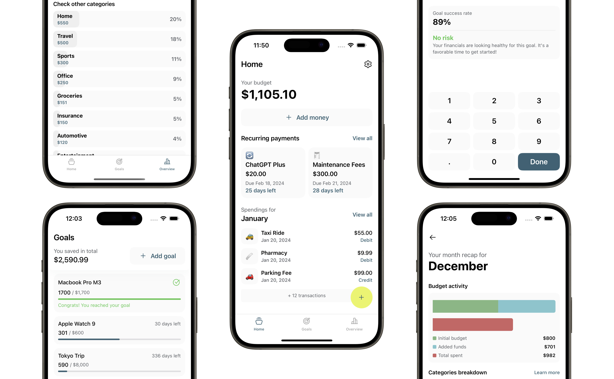

# Expensaro

A personal finance iOS application built with Swift 5, SwiftUI, and Realm.  
Expensaro helps users track day-to-day transactions, set budgets & goals, and analyse their spending habits through beautiful charts.

## Core Ideas
* **SwiftUI-first**: All new UI is implemented in SwiftUI for clarity, live previews and a declarative style.
* **Modular Feature Folders**: Each user-facing feature lives in its own *Module* folder with its own views, view-models and helpers.
* **Service / Manager Layer**: Non-UI code (network, data-base, analytics, notifications) is kept in dedicated, testable managers.
* **Navigation Abstraction**: The app uses _NavigationControllers_ & a simple router (`EXNavigationViewsRouter`) to keep navigation logic out of views.
* **Realm for Storage**: Lightweight local persistence with automatic migrations via `RealmMigrator`.

---

## Managers & Services

| File / Type                               | Purpose / Responsibility                                                                                                    |
| ----------------------------------------- | --------------------------------------------------------------------------------------------------------------------------- |
| **`MonthRecapService`**                   | Builds the monthly “Recap” dataset. Retrieves the previous month’s budget, added funds, spending, goal contributions and groups transactions by category section. Publishes everything for charts and widgets in *Overview*. |
| **`SelectedCategoryAnalyticsManager`**    | When a user opens analytics for a single category, this manager fetches that category’s transactions for the current month, produces an average-spent value and a sorted list to feed the detail view. |
| **`DailyTransactionsAnalyticsManager`**   | Collects “daily transaction” items for the current week, aggregates totals per weekday (Sun → Sat) and publishes a ready-to-plot array. Locks output when fewer than four data points exist. |
| **`NotificationManager`**                 | Thin wrapper around `UNUserNotificationCenter`. Requests permission, schedules payment-due reminders, deletes or lists pending notifications and handles foreground presentation via delegate. Implemented as a singleton because of the delegate requirement. |
| **`TopCategoryManager`**                  | Analyses transactions for the current month to find the category with the highest spend, calculates its percentage of the budget and prepares a sorted list of “other categories”. Falls back to demo data if the sample size is too small. |
| **`GoalManager`**                         | Provides a simple “success-rate” calculator for savings goals. Given budget, goal amount and days left, it derives a percentage risk level and returns descriptive text & colour for UI badges. |

---

## Navigation stack

Mix of UIKit + SwiftUI.  
All *screens* are written in SwiftUI, but they sit inside `UINavigationController` so we can:

* keep per-tab back-stacks,
* reuse standard push / pop transitions,
* control the nav-bar from UIKit when needed.

### Key pieces

| File / Type                              | Role |
| ---------------------------------------- | ---- |
| **`NavigationControllers`**              | Central “registry” that pre-creates one `UINavigationController` per feature-tab (`homeModuleNavigationController`, `goalsModuleNavigationController`, …). Each controller lives for the whole app-session so every tab remembers its own back-stack. |
| **`RootNavigationController<T>`**        | A SwiftUI `UIViewControllerRepresentable` that embeds a *given* `UINavigationController` plus the tab’s root SwiftUI view. Usage → `RootNavigationController(nav: NavigationControllers().homeModuleNavigationController, rootView: HomeFeedView())` |
| **`CustomHostingController`**            | Thin wrapper around `UIHostingController` that exposes a SwiftUI view as `UIViewController`. Keeps the generics hidden (`AnyView`) and allows small UIKit tweaks if needed (status-bar style, etc). |
| **`Router` protocol**                    | Minimal abstraction with `pushTo`, `popTo`, `popToRoot` plus an optional `nav` reference. Makes unit-testing & mocking easier. |
| **`EXNavigationViewsRouter`**            | Concrete router injected into SwiftUI via `.environmentObject`. Any view can call `router.pushTo(view: EXNavigationViewBuilder.builder.makeView(DetailView()))`. |
| **`EXNavigationViewBuilder`**            | Factory that converts a SwiftUI `View` into `UIViewController` (`CustomHostingController`). Separates **creation** from **navigation** so the router never has to know about SwiftUI generics. |
| **`UINavigationController` extension**   | Enables the interactive-pop swipe even when we hide the system nav-bar. It sets itself as the `interactivePopGestureRecognizer.delegate` and allows simultaneous recognition with scroll views. |

---

## Data Models

| Type / File                                | Stored Fields (main)                                                                  | Purpose / Notes                                                                                              |
| ------------------------------------------ | ------------------------------------------------------------------------------------- | ------------------------------------------------------------------------------------------------------------- |
| **`Budget`**                               | `amount`, `initialAmount`, `dateCreated`                                              | Represents a monthly budget. Keeps both the starting amount and current remaining balance.                   |
| **`Transaction`**                          | `name`, `amount`, `type`, `date`, `categoryName`, `categoryIcon`, `categorySection`, `note` | A single expense / income entry. Categorised via name + icon and linked to a high-level `CategoriesSection`. |
| **`DailyTransaction`**                     | Sub-set of `Transaction` fields; optimised for quick re-use                            | Template-like transactions users add frequently (e.g. “Coffee ☕️”).                                          |
| **`Category`**                             | `icon`, `name`, `tag`, `section`                                                      | Defines a selectable category. `tag` (base/custom) marks system vs user-made, `section` groups for analytics. |
| **`Goal`** + `GoalTransaction`             | `name`, `finalAmount`, `currentAmount`, `dueDate`, `transactions`                     | Savings goals. Embedded list tracks each contribution with amount, note & date.                              |
| **`RecurringTransaction`** + `PaymentContributions` | `name`, `amount`, `dueDate`, `schedule`, `reminderType`, `isReminder`, `contributions` | Subscriptions & bills that repeat over time; supports custom reminder timing and partial payments.           |
| **`DailyTransaction`**                     | `name`, `amount`, `categoryName`, …                                                   | Quick-add templates for everyday spends.                                                                     |
| **Enums**                                  | `CategoriesTag`, `CategoriesSection`, `RecurringSchedule`, `ReminderType`, `GoalSuccessRate` | Typed, persistable enums used across UI & Realm; bundle titles, colours and helper values.                   |
| **Analytics DTOs**                         | `TopCategories`, `SampleCategoriesBreakdown`, `RecurrentPaymentData`, `BudgetsDataSet`, `GoalSummary`, `GroupedTransactionsBySection`, `CombinedDailyTransactions` | Lightweight structs used only for presenting charts and analytics views. Not persisted in Realm.            |
| **`RealmMigrator`**                        | —                                                                                     | Centralised schema migration: bumps `schemaVersion` and fills default values for new fields.                 |

---

## Feature Modules

Expensaro follows a “vertical‐slice” architecture – every user-facing feature lives in its own folder under
`Expensaro/Modules/`.  
Each module owns its UI, view-models / services and helper views so you can work on it in isolation.

| Module Folder                                | Root Screen(s)                               | What the user can do here                                                                                              |
| -------------------------------------------- | -------------------------------------------- | ---------------------------------------------------------------------------------------------------------------------- |
| **Home Module**                              | `HomeView.swift`                             | Overview of current budget, latest transactions, quick actions menu.                                                   |
| **Daily Transactions Module**                | `DailyTransactionsListView.swift`            | Create “template” expenses (☕️ Coffee, 🚇 Subway) and add them with one tap.                                           |
| **Goals Module**                             | `GoalsListView.swift`                        | Create savings goals, add contributions, track progress & analytics.                                                   |
| **Overview Module**                          | `OverviewView.swift`                         | High-level analytics: top spending category, month recap, breakdown charts.                                            |
| **Settings Module**                          | `SettingsView.swift`                         | Manage categories, notifications, app settings, feedback, account reset.                                               |
| **Tab Bar Module**                           | `TabBarView.swift`                           | Hosts the 3 main tabs (Home, Goals, Overview). Sets up shared routers & nav-controllers.                               |
| **Onboarding Module**                        | `OnboardingView.swift`                       | First-time experience, permissions & currency selection.                                                               |
| **Debug Module**                             | `DebugMenuView.swift`                        | Developer-only actions: seed demo data, print pending notifications, test pushes.                                      |

> Tip: Within each module you will usually find a `Helpers` subfolder that contains lightweight, reusable sub-views or view-models that don’t warrant a top-level manager.

---

## `Source.swift`

A single, namespaced “bag of constants & helpers” used across the whole code-base.

| Namespace / Type                 | What it Stores / Does                                                                                               |
| -------------------------------- | -------------------------------------------------------------------------------------------------------------------- |
| `Source.Images.*`                | Centralised `Image` and asset names grouped by usage (**Navigation**, **Tabs**, **System**, etc.). No hard-coded strings inside views. |
| `Source.Strings.*`               | User-facing copy & small enums that power empty states, toggle cards, alerts, dialogs and bottom sheets (<code>InfoCardType</code>, <code>AlertType</code>, …). |
| `Source.Functions`               | Pure helper functions (date → string, current month, TimeZone conversion, previous-month range, etc.). No side-effects. |
| `Source.Realm`                   | Factory methods that create pre-populated Realm objects for tests, previews and demo data (`createTransaction`, `createGoal`, …). |
| `Source.DefaultData`             | Ready-to-insert demo content: sample transactions, budgets, categories, goals and recurring payments. Used by Debug Menu and onboarding seeding. |
| Global helpers                   | `randomDateInCurrentMonth()` / `randomDateInPreviousMonth()` – utility functions that create random dates for the demo transactions. |
| Misc constants                   | `wishKEY`; `adminMode` flag (on when launched with `-adminMode`). |

Keeping these values in a single file avoids “stringly-typed” errors and makes localisation / asset swapping easier.

